# GPU SfM: architecture priorities and quality constraints

Research and local measurements checked on 2026-10-17. This is an implementation
decision record, not a claim that TypeCV already matches COLMAP across datasets.

## Acceptance

Speed must be compared at equivalent reconstruction quality. Do not obtain a
speedup by dropping difficult frames, reducing observation coverage, relaxing
geometric validity, lowering solver accuracy, or silently using lower resolution.
Record source resolution, analysis resolution, adapter, peak resident memory,
first-use latency, steady-state latency, and every non-GPU stage separately.

Use both references:

1. COLMAP with exactly the same feature identities, pixels, putative matches and
   fixed intrinsics isolates the geometry implementation.
2. Full COLMAP feature extraction, matching and mapping measures the frontend's
   coverage as well. Successful geometry on imported matches is insufficient to
   establish a comparable full pipeline.

Compare registered cameras, track/observation coverage, aligned camera errors and
residuals on shared observations. Different accepted observation sets make raw
mean residuals incomparable. COLMAP is a reference, not ground truth; calibrated
multi-scene data and pose AUC are still required for an accuracy claim. COLMAP's
half-pixel convention and image IDs assigned during extraction must be normalized
using filenames, not assumed database order.

## Evidence selecting the first change

The eight-frame 640 x 360 pyramid input has SHA-256
`851f71849a428edc0d81f118dab52bcfdbb2d0bd93cc5ab96d626ece9f1c5806`.
The 800-feature smoothed BRIEF experiment registered 8/8 cameras and 726 points,
with approximately 6.0 s warm end-to-end latency on an RTX 2080. It is a richer
workload than the previous 400-feature result (4/8 cameras, 98 points, 1.5 s).
Their times are not an equivalent-quality acceleration comparison.

The identical eight-JPEG, 800-feature, smoothed, single-scale run was repeated
after adding persistent GPU state across successful worker jobs. Matching,
shared-focal refinement and timestamp settings were unchanged. Mean warm
end-to-end latency fell from 6,002.9 ms to 2,411.9 ms (2.49x); first-call
latency fell from 41,290.8 ms to 36,491.8 ms (1.13x). Each run registered all
eight views and returned 726 points and 1,895 observations, with mean reprojection
error 0.2944715 px. This is an observed same-output speedup on this fixture, not
a 100x result or a general accuracy-parity claim. The remaining warm stage time
is concentrated in pair verification (1,003.6 ms, 18 calls; 42%), bundle
adjustment (648.7 ms, 8 calls; 27%) and PnP (364.6 ms; 15%). These are the next
measured runtime targets; cold startup remains a separate problem.

On the same image set, full COLMAP registered 8 views with 2,515 points and
8,467 observations. The controlled same-feature COLMAP run registered 8 views,
730 points and 2,044 observations. These counts show frontend and mapping
coverage gaps, but are not ground-truth quality comparisons: accepted tracks
differ, and no calibrated camera-pose ground truth is available. The local
pycolmap 4.2.1 Windows wheel reports no CUDA support, so its full-pipeline result
is not a comparison against CUDA-enabled COLMAP.

A separate timestamp-query BA experiment uses that reconstruction's eight
cameras, 726 points and 1,895 observations with deterministic perturbations. The
input and perturbation hashes are fixed in
`work/benchmark-results/sfm-bundle-profile*.json`. Before parallel camera
kernels, mean warm wall time was 1,915.8 ms and GPU compute 582.982 ms. The
parallel f64 kernels reduced these to 1,463.15 ms and 124.855 ms, respectively
(1.31x warm wall speedup; 4.67x GPU compute speedup). All eight LM steps were
accepted, RMSE fell from 1.17296 to 0.39237 px, and GPU-vs-CPU coordinate RMS
was below 3e-11 on this case. This is verified for this small scene, not a
large-scene or end-to-end quality claim.

The implemented GPU path distributes camera-block assembly by row, inverse
solves by column, and Schur multiplication by camera component. It preserves
the f64 objective and solver tolerances and adds 36 f64 scratch values per
camera. Kernel timing moved the dominant cost: `bundleSchurCamera` is now 48.8%
of warm GPU time, `advanceBundleCg` 26.2%, `bundleCameraRows` 12.7%, and
`bundleSchurPoint` 4.9%. This profile selected PCG orchestration and repeated
dispatches as the next target; the persistent-CG result below measures that
follow-up change.

The persistent solve runs in a single 64-lane workgroup. It reduces small-scene
latency, but does not establish full RTX 2080 utilization or scalable large-scene
throughput; its 9.19x BA wall-time result must not be extrapolated to larger
problems. WGSL workgroup barriers synchronize only lanes in that workgroup, so a
single persistent loop cannot safely serve as a global barrier across many
independent workgroups.

A control run with solver checkpoints disabled is not a resident-loop result:
it executed the configured 96 PCG iterations for each of eight LM steps rather
than stopping after 261 measured CG iterations. Warm wall time rose to 2,695.75
ms (1.84x slower than checkpointed) while GPU compute rose to 133.073 ms; the
672-byte readback reduction did not compensate for the extra no-op dispatches.
The then-proposed next step was to move small-scene PCG iteration/control onto
the GPU while retaining convergence checks and the host-checkpointed path as a
fallback for larger or less predictable systems. Any fused/fixed-block
iteration must match the f64 CPU oracle, accepted-step decisions, final cost,
and RMSE; disabling checkpoints globally has already failed the latency test.

The implemented persistent-CG path removes that host-stepped loop for unbounded
WebGPU runs when `observations * maxCgIterations <= 262,144`. One 64-lane
workgroup iterates the full PCG solve with workgroup barriers and checks the
residual on-device. CPU, bounded-submission, and larger products retain the
checkpointed fallback. On the identical C8/P726/M1895 input and hashes, three
runs produced identical outputs: 261 CG steps, eight accepted and zero rejected
LM steps, final cost 291.62534730900916, RMSE 0.39236584240686634 px, and maximum
GPU-vs-CPU coordinate error 8.7e-11. Mean warm wall time was 208.55 ms and mean
timestamped GPU compute 95.727 ms. That is 9.19x faster in BA wall time and
6.09x in GPU compute than the original profile; relative to parallel camera
kernels alone, it is 7.02x faster in wall time. A later full eight-JPEG pipeline
run with persistent GPU state measured 2.49x lower warm latency with unchanged
reconstruction counts and reprojection error on this fixture. The BA profile
and full-pipeline result are separate measurements; neither establishes 100x
acceleration or broad dataset parity.

Later change: the fixed-focal route's persistent kernel was removed. One
dispatch ran the whole PCG loop of an LM iteration, longer than a GPU watchdog
allows on some devices. The loop now runs as chunks of the time budget, with the
activity flags read after each chunk ([GPU SfM](gpu-sfm.md), "The BA's PCG
loop"). The measurements above describe the removed kernel. The shared-focal
route keeps its persistent kernels.

Amdahl's law explains why the much larger BA-only speedup does not translate
directly to the full pipeline. An earlier stage profile put BA at roughly 70%
of runtime, implying an approximately 2.7x total-run ceiling if BA alone gained
9.19x and every other cost stayed constant. That was an inference; the measured
full-pipeline warm speedup is 2.49x. Pair verification now accounts for 42% of
the measured warm stages, with BA at 27% and PnP at 15%. Resident graph and
global reconstruction work therefore remain the main architecture target after
these kernel improvements.

## Research informing the architecture

| Work                                                                                                             | Transfer to TypeCV                                                                                                                | Constraint                                                                                                                                                                                             |
| ---------------------------------------------------------------------------------------------------------------- | --------------------------------------------------------------------------------------------------------------------------------- | ------------------------------------------------------------------------------------------------------------------------------------------------------------------------------------------------------ |
| [InstantSfM](https://arxiv.org/html/2510.13310v3), [implementation](https://github.com/cre185/InstantSfM)        | GPU global positioning, resident active observations and dynamic sparse-system compaction                                         | Published large-scale results use much larger GPUs; do not transfer their speed factors to WebGPU or an 8 GB card.                                                                                     |
| [GLUEMAP (2026)](https://arxiv.org/html/2605.26103v1), [implementation](https://github.com/colmap/gluemap)       | Sparse view graph, independent local stars, global synchronization and geometry refinement combining learned and classical tracks | Global attention over independent image crops is not equivalent. Local inference and overlap checks must preserve cross-star connectivity.                                                             |
| [Caspar (2026)](https://arxiv.org/html/2605.30583v1), [implementation](https://github.com/symforce-org/symforce) | Symbolic residual/Jacobian kernels and expression-DAG ordering to reduce GPU register pressure                                    | CUDA implementation is an architectural reference, not a TypeShade dependency or a demonstrated WebGPU speedup.                                                                                        |
| [Graphite](https://arxiv.org/html/2509.26581v1), [implementation](https://github.com/sfu-rsl/graphite)           | In-place optimization, dynamically computed Jacobians and mixed-precision solving                                                 | A global f64-to-f32 substitution is insufficient. TypeCV's experimental substitution failed geometric quality checks.                                                                                  |
| [FastMap](https://arxiv.org/abs/2505.04612), [implementation](https://github.com/pals-ttic/fastmap)              | Preaggregate per-pair epipolar terms into a compact quadratic statistic and fuse small pose-update operations                     | The official implementation warns of lower robustness than COLMAP/GLOMAP and catastrophic failures with sparse coverage, poor matches or degenerate motion. Preserve robust verification and final BA. |
| [LightGlue](https://arxiv.org/abs/2306.13643), [implementation](https://github.com/cvg/LightGlue)                | Learned matching with adaptive depth/width after robust local feature extraction                                                  | Model import and efficient attention kernels must be established in TypeNN; ordinary Conv2d support alone is not a ready model runtime.                                                                |

These papers support different stages and evaluation conditions. Their largest
reported kernel or large-scene speed factors cannot be multiplied into an
end-to-end TypeCV prediction.

## Long kernels under a GPU watchdog: what the literature says (2026-10-19)

The question: a RANSAC search, a Jacobi SVD or a solver iterates inside one dispatch, a
watchdog resets the device after about two seconds (Windows) or sooner (iOS Safari), and
the choice was between cutting the kernels by hand (#49, #50) and asking the compiler to do
it. These sources were read on 2026-10-19; the implications are inferences, labeled as such.

**Facts from the sources.**

- NVIDIA's Iray renderer (Keller et al., 2017, appendix A.4) splits long kernels by sample
  count, "aiming for about 1 second execution time per kernel", and the host "communicates
  through mapped memory to the GPU kernel that a timeout is imminent"; the kernel checks that
  flag and aborts, and a per-pixel sample-count buffer lets the next kernel continue. The
  resumable state is the renderer's own design, not the compiler's.
- Cooperative kernels (Sorensen et al., 2017) add `offer_kill` and `request_fork` so a long
  workgroup yields at author-placed safe points; a killed workgroup saves no state, and the
  authors reject preemption with state capture as too costly (registers and shared memory of
  up to 1024 threads). Compiler placement of the safe points is listed as future work. The
  overhead without multitasking is a geometric mean of 1.07x.
- Hummingbird (2026) splits a kernel at run time by rewriting its PTX to offset `blockIdx`,
  so a grid launches as sub-grids; it does not split a loop inside a thread, and it refuses
  kernels with grid-wide synchronization. Its split size comes from profiling, not from a
  budget inside the kernel.
- Meganeura (2026, Vulkan and Metal training) measures the cost of chunking a dispatch:
  about 18.5% at 16 chunks in isolation, and a gain under graphics co-tenancy.
- Futhark compiles a sequential `loop` whose body holds parallel operations as host-side
  iteration over kernels, and sequentializes irregular inner parallelism into per-thread
  loops; a plain loop is not parallel by itself. No array-language compiler in the sources
  turns a per-thread loop into a resumable sequence of dispatches.
- Batched small factorizations (Boukaram et al., 2017, "Batched QR and SVD Algorithms on
  GPUs") keep a small matrix in registers with "one row per thread" and "each operation
  assigned to a warp", several matrices per block; the one-sided Jacobi column pairs are
  processed one at a time per warp with the three dot products as warp-shuffle reductions,
  and registers spill past size 30. MAGMA ships `gesvj_batched` for the same shapes, and the
  ORNL work on tiny factorizations states that "sub-vector/warp in size" matrices need a
  different mindset from one thread per matrix.
- Kornia's batched CUDA RANSAC (PR #4979, 2026) draws hypotheses in batches of 2048
  (epipolar) or 8192 (homography) per call, checks PROSAC termination (Chum and Matas, 2005)
  between batches, and replaced a per-matrix QR by a batched Jacobi SVD: a 2048-hypothesis
  batch went from about 250 ms to about 1 ms. The eight-point solver is compute-bound past
  2048 hypotheses: 6 ms per 2048 and 23 ms per 8192 on an RTX 4090.
- WebGPU has no host-writable memory a running dispatch can poll, so Iray's stop flag has no
  equivalent: the host can only size the next submission. WebGPU does have
  `dispatchWorkgroupsIndirect`, a workgroup count read from a buffer the GPU wrote.

**Inferences for TypeCV.**

1. The state machine of #49 and #50 is the design every source uses for a loop that must
   span submissions: the author keeps the cursor and the loop-carried state in buffers, and
   each dispatch advances it. No source delegates that to a compiler. The time budget of
   #49 is Iray's "about 1 second" with a smaller number and no in-kernel abort.
2. The real defect of the pair search was the batch, not the per-thread loop. One thread per
   9x9 matrix is what MAGMA's register kernels do for tiny matrices; they saturate the GPU
   with thousands of matrices per launch. TypeCV ran 8 to 32 models per batch, so a dispatch
   held 8 to 32 lanes of serial work and its latency was that serial chain. Kornia's batch is
   2048 and its termination check runs between batches, as TypeCV's adaptive stop does.
3. The next change is therefore the batch: hundreds to thousands of trials per dispatch,
   bounded by memory (about 1 KB per model) and by the adaptive stop's granularity, measured
   on SwiftShader and on the owner's devices. A cooperative kernel (one workgroup or one
   subgroup per model, rows across lanes, warp-shuffle dot products) is the second step and
   cuts the latency of a batch further; TypeShade has `workgroup<T>`, `workgroupBarrier()`
   and `enable subgroups`, so it is expressible today.
4. Scoring is grid-parallel and can be split as Hummingbird splits: a sub-range of the grid
   per dispatch, with an offset. That is the one place a generic split applies.

**Inferences for TypeShade.**

- Change 0074 (accepted) puts the budget, the fence, the clock and the rate table in the
  device owner. That is the runtime half of Iray's mechanism and is as far as the sources
  go for a runtime.
- Indirect dispatch (`dispatchWorkgroupsIndirect`) is the missing primitive: the GPU decides
  the next batch's workgroup count from the adaptive stop, and the host reads nothing
  between batches. The runtime does not expose it. A proposal is the next compiler step.
- A compiler pass that turns a per-thread loop into resumable chunks has no precedent in
  these sources. Cooperative kernels place the safe points by hand; Iray keeps its own
  cursor. The compiler's part is to make the author's state machine cheap (0074, indirect
  dispatch, subgroup operations), not to invent the state.

**Sources.** Keller et al., "The Iray Light Transport Simulation and Rendering System",
arXiv:1705.01263 (appendix A.4). Sorensen, Donaldson, Batty, Gopalakrishnan, Rakamaric,
"Cooperative Kernels: GPU Multitasking for Blocking Algorithms", arXiv:1707.01989.
"Hummingbird: SLO-Oriented GPU Preemption at Microsecond-scale", arXiv:2601.04071.
"Meganeura: Portable GPU Training and Inference through Vulkan and Metal", arXiv:2608.01563.
Henriksen et al., "Futhark: Purely Functional GPU-Programming with Nested Parallelism and
In-Place Array Updates", PLDI 2017, and the Futhark performance guide. Boukaram, Turkiyyah,
Ltaief, Keyes, "Batched QR and SVD Algorithms on GPUs with Applications in Hierarchical
Matrix Compression", arXiv:1707.05141. Abdelfattah et al., "Batched one-sided factorizations
of tiny matrices using GPUs", ORNL. Kornia pull request #4979 (batched CUDA RANSAC, PROSAC
termination). MDN, `GPUComputePassEncoder.dispatchWorkgroupsIndirect()`.

## Target data flow

```mermaid
flowchart LR
  S[Source video or region decoder] --> T[Bounded overlapping source tiles]
  T --> F[GPU feature pyramid and local refinement]
  F --> D[Resident sharded descriptors]
  D --> V[Sparse view graph and verified correspondences]
  V --> L[Parallel local reconstruction or learned local stars]
  L --> G[Robust global synchronization and positioning]
  G --> O[Resident active observation graph]
  O --> B[Sparse GPU BA and precision validation]
  B --> R[Camera and structure results]
```

## Ranked implementation priorities

1. **Completed: parallel camera kernels and bounded persistent PCG.** The
   identical C8/P726/M1895 case now runs BA 9.19x faster in warm wall time than
   the initial profile while retaining f64 CPU agreement. The one-workgroup
   PCG path is limited to unbounded WebGPU runs under its product bound; retain
   checkpointed fallbacks and the solver/coordinate quality gates.
2. **Next: optimize pair verification and keep the sparse observation graph and
   solver state resident.** Pair verification is currently 42% of measured
   warm stage time. Keep
   camera/point state, active masks, CSR adjacency, robust weights and solver
   workspace on GPU; compact active indices in kernels and read final outputs
   rather than repacking full models. Preserve stable public feature IDs through
   explicit compact-index maps. Reduce repeated reconstruction snapshots and
   plan setup. For larger scenes, the proposed next architecture is to batch
   independent, verified local BA windows or local stars across workgroups to
   provide enough parallel work to fill the GPU, then retain robust global
   synchronization and a final global BA with existing quality gates. This is
   a proposal informed by GLUEMAP, not implemented behavior. The current BA limit
   is 64 cameras; until that architecture is validated, use the memory-bounded
   fallback. Do not claim scale until a real long sequence passes.
3. **Support 18K–32K spatial dimensions with bounded source tiling.** Stream
   overlapped image regions under a fixed byte budget, keep only capped resident
   descriptors and a short temporal feature window, and schedule tiles without
   allocating a full-resolution image pyramid or all-frame attention. Tile
   halo must cover the actual feature model's receptive field; preserve global
   pixel coordinates and cross-tile matching. Prove bounded peak memory and
   reconstruction quality on actual high-resolution video; planner coverage or
   a thin procedural image alone is insufficient.
4. **Improve correspondence coverage with measured learned features/matching.**
   Import an exact pretrained model through TypeNN and measure its real operators
   and memory before adopting it. Keep geometric verification and BA; assess
   registered views, track coverage and reprojection quality on the same images.
5. **Address cold start separately.** Measure shader compilation and device
   setup apart from steady-state execution. Use only a supported pipeline
   preparation/cache API; do not present a warm-only improvement as end-to-end
   acceleration.

## Memory and precision contracts

Spatial source resolution and the number of frames are independent axes. Avoid
full-resolution image-pair matrices and all-frame attention. Retrieve sparse
neighbors, keep graph bridge/loop edges, and shard descriptors by binding limits.
Sparse solver storage should scale with active cameras, points and observations;
do not construct dense camera-by-point Jacobians or a dense full normal matrix.
The persistent workgroup route's `observations * maxCgIterations` bound and
current 64-camera BA ceiling are explicit limits. Larger scenes must use the
checkpointed fallback or bounded local problems and global synchronization
until sparse state and convergence control fit measured binding and memory
limits. TypeCV already has matrix-free Schur PCG, so merely renaming that
mechanism adds no capability.

Coarse images may discover connectivity and initialize poses. Final source-level
feature localization/refinement must read the needed original tiles if the claim
is source-resolution accuracy. Halo size depends on the actual feature network
receptive field and stride; FAST/BRIEF's 24-pixel halo is not a universal learned
feature halo. Maintain pixel-center coordinate transforms and global feature IDs
at tile seams. A 32K metadata label or procedural thin-image test is not a 32K
video accuracy/throughput result. Decoder codec/dimension limits are also a
separate ingestion constraint.

Mixed precision may accelerate a well-conditioned linear subproblem only after
an f64 residual/cost certificate and iterative correction or GPU precision
escalation meet the original accuracy criterion. Keep camera/geometry acceptance
tests and final BA quality thresholds. Never quietly lower thresholds to make an
unsafe lower-precision route look valid.

## Reproduction tools

- `scripts/benchmark-sfm-pyramid-e2e.mjs`: exact JPEGs, resident features/matching,
  mapping, cold/warm timings, model export and independent CPU comparison.
- `scripts/profile-sfm-bundle.mjs`: timestamp-query BA profiling, including the
  checkpointed control, the intentionally slower checkpoints-disabled control,
  and the implemented persistent-CG path. These measurements isolate BA and
  must not be reported as whole-pipeline latency.
- `scripts/benchmark-colmap.py`: independent full and controlled COLMAP runs.

The locally available pycolmap 4.2.1 Windows wheel reports no CUDA support. Its
CPU timing remains a useful comparator, but does not establish performance
against a CUDA-enabled COLMAP build. Timestamp-query profiling itself changes
execution overhead and is not interchangeable with the normal latency run.
